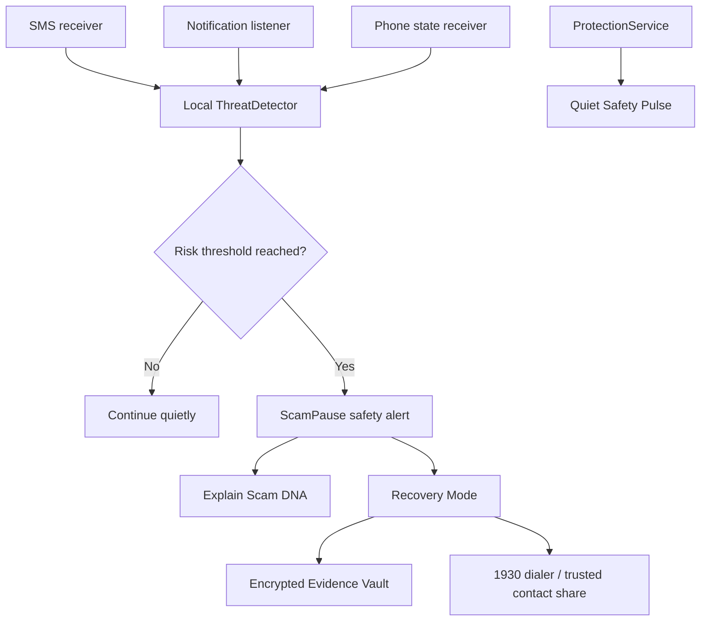

# SurakshaSetu Technical Design

## Product goal

SurakshaSetu is an Android-first, privacy-preserving decision firewall. It detects combinations of scam signals and gives the user a calm pause before they share credentials, follow a suspicious link, or make a payment.

## Architecture

## Components

| Component | Responsibility |
|---|---|
| `MainActivity` | ScamPause UI, onboarding, settings, recovery, evidence history |
| `ThreatDetector` | Local rule-based scoring and explanations |
| `SmsReceiver` | Receives permitted SMS events |
| `ThreatNotificationListener` | Reads permitted notification text for risk signals |
| `CallReceiver` | Receives phone-state events and applies call warnings |
| `ProtectionService` | Keeps protection active with a quiet foreground status |
| `SecureStore` | Encrypts evidence with an Android Keystore AES-GCM key |

## Data flow and privacy

1. Signal text is inspected locally.
2. The detector produces a bounded 0–100 risk score.
3. Only a local alert and explanation are generated.
4. Evidence is encrypted before local persistence.
5. No message content is uploaded by this prototype.
6. Sharing is always user-initiated through Android's share sheet.

## Environment and build

No runtime secrets or environment variables are required for the local prototype. The build uses Android SDK 35, Java 21, Android Gradle Plugin 8.13, and Gradle 8.x. `local.properties` is intentionally ignored because it contains a machine-specific SDK path.

## Threat-model boundaries

The prototype does not control banking apps, move money, silently record calls, or guarantee detection. Android permissions and manufacturer policies can limit call-number visibility and background behavior. Production deployment requires Play policy review, device-matrix testing, and a security/privacy audit.

